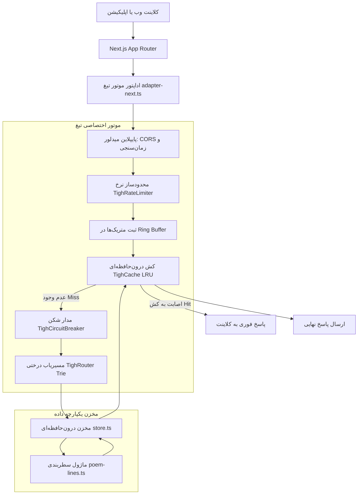

# معماری و سازوکار پروژه Persian-Quote-API

این سند ساختار جامع، اهداف، پایپلاین داده‌ها، الگوریتم‌های پردازش شعر و جزئیات موتور تیغ (Tigh Engine) را توضیح می‌دهد.

---

## ۱. هدف پروژه

پروژه Persian-Quote-API یک بستر متن‌باز و رابط برنامه‌نویسی کاربردی (RESTful API) برای ادبیات فارسی است. اهداف بنیادین این پروژه عبارتند از:

1. **دسترسی عمومی و رایگان**: ارائه دسترسی مستقیم به گنجینه شعر و نثر فارسی بدون نیاز به ثبت‌نام، دریافت کلید API، یا پرداخت هزینه.
2. **پوشش دوگانه شعر کهن و معاصر**: گردآوری و سامان‌دهی اشعار کلاسیک (حافظ، مولانا، سعدی، فردوسی)، شعر نو و نیمایی (نیما یوشیج، سهراب سپهری، احمد شاملو، فروغ فرخزاد، اخوان ثالث)، و سخنان گهربار شخصیت‌های تاریخی.
3. **کارایی بالا و تأخیر کم**: پیاده‌سازی موتور پردازشی سبک و اختصاصی در حافظه به جای تکیه بر پایگاه‌های داده سنگین خارجی، تا زمان پاسخ به زیر یک میلی‌ثانیه برسد.
4. **ابزارهای تعاملی برای وب**: در اختیار گذاشتن ویجت‌های قابل تعبیه در وب‌سایت‌ها، مستندات پویا و زمین بازی زنده برای آزمایش درخواست‌ها.

---

## ۲. چرخه حیات داده‌ها و نحوه افزودن شعر

سیستم داده‌های پروژه بدون وابستگی به سرور دیتابیس خارجی و به صورت بارگذاری در حافظه (In-Memory Data Store) کار می‌کند.

### ۲.۱ منابع داده (JSON Datasets)
داده‌ها در مسیر `lib/data/` به صورت پرونده‌های ساختاریافته نگهداری می‌شوند:
- `hafez.json`: دیوان کامل حافظ شامل ۴۹۷ غزل با تفکیک ابیات و مصراع‌ها.
- `shereno.json`: بیش از ۴۰۰۰ قطعه شعر نو با مشخصات عنوان، شاعر، و نام کتاب یا دفتر شعر.
- `poetry-quotes.json`: بیش از ۴۱۰۰ بیت و گزیده‌شعر کلاسیک موضوع‌بندی‌شده همراه با ترجمه انگلیسی.
- `non-poetry-quotes.json`: سخنان و جملات قصار نثر تاریخی با پالایش ورودی‌های ناقص.

### ۲.۲ بارگذاری و نرمال‌سازی در حافظه (`lib/data/store.ts`)
هنگام آغاز اجرای برنامه، مخزن داده در یک گذر پردازشی اقدامات زیر را انجام می‌دهد:
- **یکسان‌سازی حروف و نویسه‌ها**: تبدیل نویسه‌های عربی و فارسی متداول (مانند تبدیل «ي» به «ی» و «ك» به «ک»)، حذف اعراب، حذف کشیده (تطویل)، پاکسازی فاصله‌های مجازی غیرضروری و تبدیل ارقام به یک فرم پایه.
- **پالایش خودکار**: شناسایی و حذف رکوردهای تکراری و حذف داده‌هایی که متن یا نام پدیدآورنده ندارند.
- **جدول معادل‌های شاعران (Canonical Alias Map)**: نگاشت املای متداول، اشتباهات رایج (مثل «هافظ» به «حافظ») و نام‌های لاتین (مانند «rumi» و «mawlana» به «مولانا») به هویت یکتا.
- **نمایه‌سازی ساختاریافته**: دسته‌بندی اشعار بر اساس شناسه معیار شاعر در ساختار `Map<string, NormalizedQuote[]>` برای جستجوی O(1) و به‌کارگیری فاصله لون‌اشتاین (Levenshtein) در غلط‌یابی فازی نام‌ها.
- **آماده‌سازی شاخص جستجو**: اتصال فیلدهای غیرقابل شمارش به اشیاء برای امتیازدهی فوری بدون سربار ساخت اشیاء جدید در حافظه.

### ۲.۳ شیوه مشارکت جامعه (`/contribute`)
کاربران برای افزودن اشعار جدید از صفحه `/contribute` استفاده می‌کنند:
- فرم بر اساس اعتبارسنجی Zod ورودی‌های نام شاعر، متن شعر، ترجمه، موضوع و منبع را بررسی می‌کند.
- برای حفظ امنیت پایگاه کد و جلوگیری از نفوذ، دستور SQL استانداردی تولید می‌شود.
- نشانی وب مستقیمی به بخش ثبت فایل جدید در مخزن گیت‌هاب ساخته می‌شود تا مشارکت‌کننده تغییرات را در قالب Pull Request به مسیر `scripts/contributions/quote_[timestamp].sql` ارسال کند.

---

## ۳. بازسازی و نحوه نمایش شعر نو (Shereno Layout Engine)

یکی از چالش‌های اصلی در پردازش دیجیتال شعر معاصر، از دست رفتن ساختار سطربندی و پلکانی در خروجی‌های خام است.

### ۳.۱ مسئله ساختار سطری
در داده‌های خام و خروجی‌های متنی متداول، شکست خطوط اصلی اغلب به فاصله تبدیل شده و متن شعر به صورت یک پاراگراف به هم پیوسته درآمده است. تنها نشانه‌های بازمانده در منبع، ستاره‌های جداکننده بند (`*`) یا فاصله‌های دوگانه میان عبارات هستند.

### ۳.۲ لایه‌های پردازش سطر در `lib/data/poem-lines.ts`
موتور چیدمان شعر از یک خط‌لوله سه‌لایه بهره می‌برد:
1. **حالت خام (raw)**: متن بدون دستکاری و تنها با یکسان‌سازی نوشتاری ارائه می‌شود.
2. **حالت نشانه‌ها (separators)**: ستاره‌ها به عنوان مرز بند و فاصله‌های پهن به عنوان شکست سطر شناسایی و تبدیل می‌شوند.
3. **حالت بازسازی هوشمند (reconstructed)**: چنانچه متنی هیچ نشانه‌ای از ساختار سطر نداشته باشد، با استفاده از الگوریتم برنامه‌ریزی پویا (Dynamic Programming) ساختار سطری آن بازسازی می‌شود:
   - طول بهینه سطرها با هدف میانگین ۲۴ نویسه (در بازه مجاز ۸ تا ۶۴ نویسه) تنظیم می‌شود.
   - قوانین زبانی رعایت می‌شود؛ سطر هرگز پیش از پسوندهای دستوری و رابط‌ها (مانند «را»، «است»، «شد»، «نیست») یا پس از پیشوندهای متصل (مانند «می»، «نمی»، «بی») نمی‌شکند.
   - توقف در نشانه‌های نگارشی (مانند «،»، «؛»، «؟»، «!») دارای امتیاز مثبت است و توقف روی حروف ربط ناخوشایند (مانند «و»، «که»، «به») مشمول جریمه محاسباتی می‌شود.
4. **کشینگ تنبل (Lazy Layout Caching)**: نتیجه تحلیل هر شعر درون `WeakMap` ذخیره می‌شود تا فقط در زمان نخستین واکشی محاسبه گردد و در درخواست‌های بعدی پاسخی فوری داشته باشد.

### ۳.۳ پارامتر lines در اندپوینت‌ها
مصرف‌کننده API می‌تواند با پارامتر `lines` رفتار نمایش را انتخاب کند:
- `auto`: حالت پیش‌فرض؛ استفاده از نشانه‌های واقعی و در صورت نبود نشانه، بازسازی سطور.
- `separators`: فقط استفاده از نشانه‌های موجود در منبع.
- `raw`: متن دست‌نخورده منبع بدون تغییر چیدمان.

خروجی پاسخ با فیلد `line_origin` وضعیت منبع سطرها (`raw`، `separators`، یا `reconstructed`) را گزارش می‌دهد.

---

## ۴. معماری فنی سیستم و موتور تیغ (Tigh Engine)

برای حذف لایه‌های سنگین فریم‌ورک‌های متداول و دستیابی به پایداری بالا، هسته سرور درون پوشه `lib/engine/` به زبان تایپ‌اسکریپت پیاده‌سازی شده است.

### ۴.۱ ماژول‌های موتور تیغ
1. **مسیریاب درختی (TighRouter)**: پیاده‌سازی شده بر مبنای ساختار پیشوندی (Trie). این سازوکار برخلاف جستجوهای خطی، در زمان نزدیک به O(1) مسیرها را تفکیک می‌کند و از پارامترهای پویا مانند `[poet]` و `[category]` پشتیبانی می‌نماید.
2. **کش درون‌حافظه‌ای (TighCache)**: جدول درهم‌سازی متصل به لیست پیوندی دوطرفه (LRU Cache) با گنجایش ۵۰۰۰ مدخل، انقضای زمانی مبتنی بر TTL، و ردیابی خودکار مصرف حافظه.
3. **محدودکننده نرخ (TighRateLimiter)**: جلوگیری از بار اضافه با سه الگوریتم سطل توکن (Token Bucket)، پنجره لغزان (Sliding Window) و پنجره ثابت (Fixed Window) بر پایه نشانی IP کلاینت.
4. **مدار شکن خودترمیم (TighCircuitBreaker)**: ماشین وضعیت سه‌حالته (بسته، باز، نیمه‌باز) برای پیشگیری از گسترش خرابی در صورت بروز خطای زنجیره‌ای.
5. **شمارنده و متریک‌ها (TighMetrics)**: ذخیره‌سازی داده‌های آماری در یک بافر حلقوی (Ring Buffer) جهت محاسبه صدک‌های تاخیر (P50، P90، P95، P99) و نرخ اصابت کش.
6. **اداپتور وب (`adapter-next.ts`)**: تبدیل روان اشیاء درخواست و پاسخ Next.js به ساختارهای استاندارد موتور تیغ.

---

## ۵. لایه‌های نمایش و تعامل کاربری

پروژه افزون بر پاسخ‌های خام JSON، چندین روش برای مشاهده و ادغام شعرها فراهم ساخته است:

1. **رابط کاربری و جستجوی زنده (`/`)**: صفحه اصلی با فونت وزیرمتن، کارت‌های واکنش‌گرا و قابلیت کپی آسان ابیات.
2. **مستندات تعاملی (`/docs`)**: راهنمای یکپارچه تمام اندپوینت‌ها با امکان ارسال درخواست آزمایشی و مشاهده ساختار پاسخ.
3. **نمونه‌های کد (`/examples`)**: راهنمای استفاده از API در زبان‌های مختلف (جاوااسکریپت، پایتون، سی‌شارپ، گو).
4. **سازنده ویجت تعبیه (`/embed` و `/api/embed`)**: ابزار ساخت ویجت متنی یا تصویری آی‌فریم با ۵ تم رنگی (پیش‌فرض، شیک، مینیمال، کلاسیک، مدرن) و امکان نوسازی خودکار برای وبلاگ‌ها و وب‌سایت‌ها.
5. **رصدخانه زنده معماری (`/sakhtar`)**: نمایشگر لحظه‌ای متریک‌های موتور تیغ، وضعیت مصرف حافظه، و پایش بنچمارک عملکرد.
